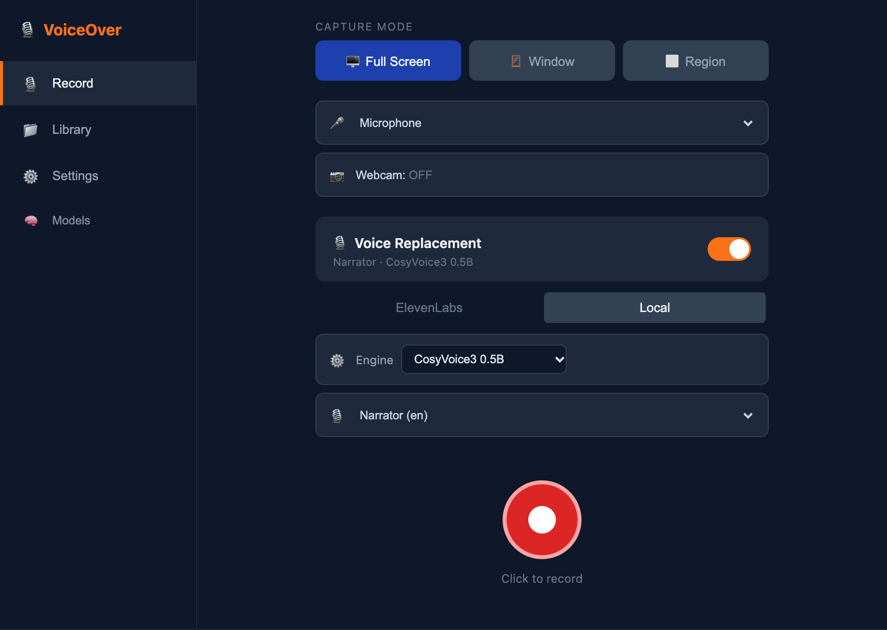
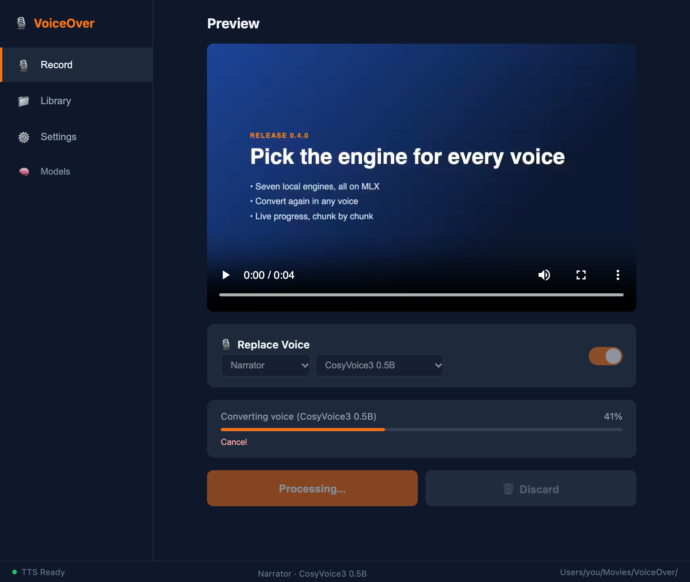
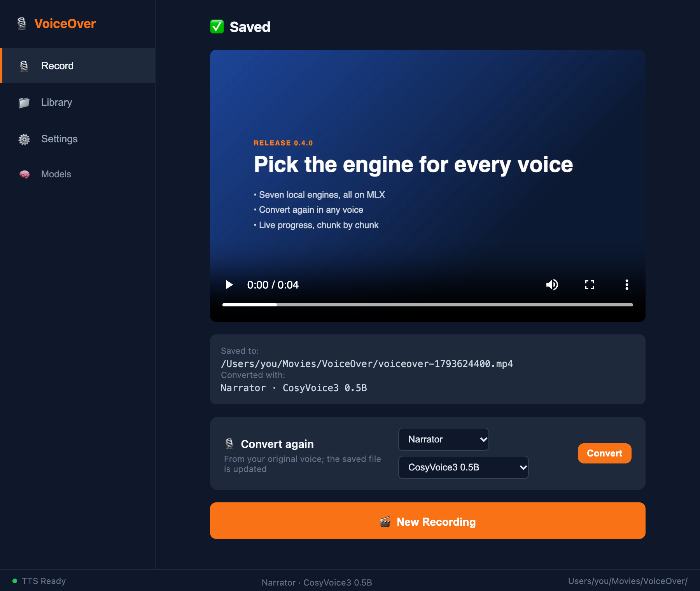
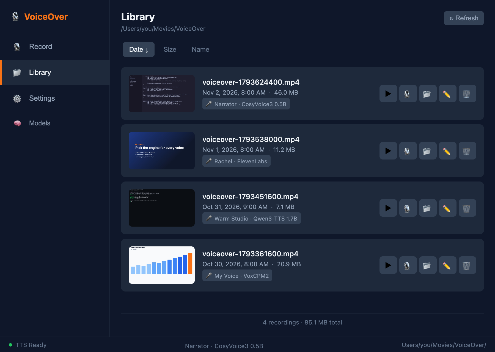
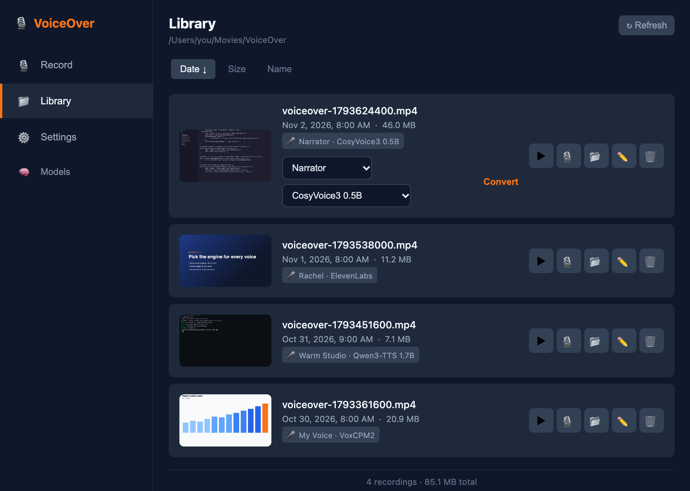
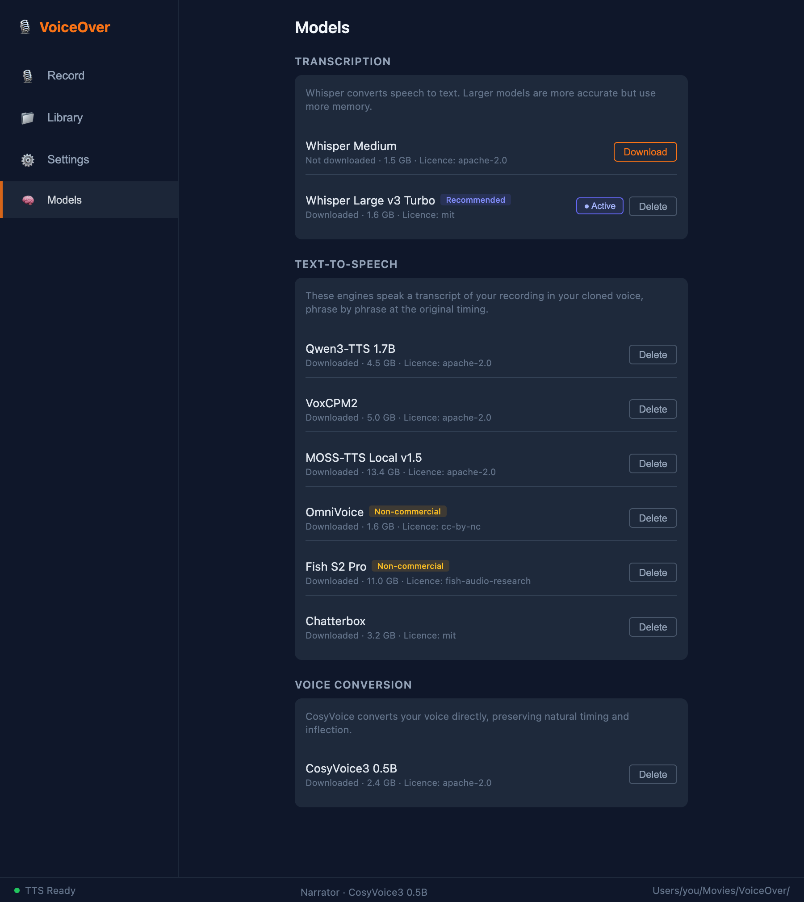
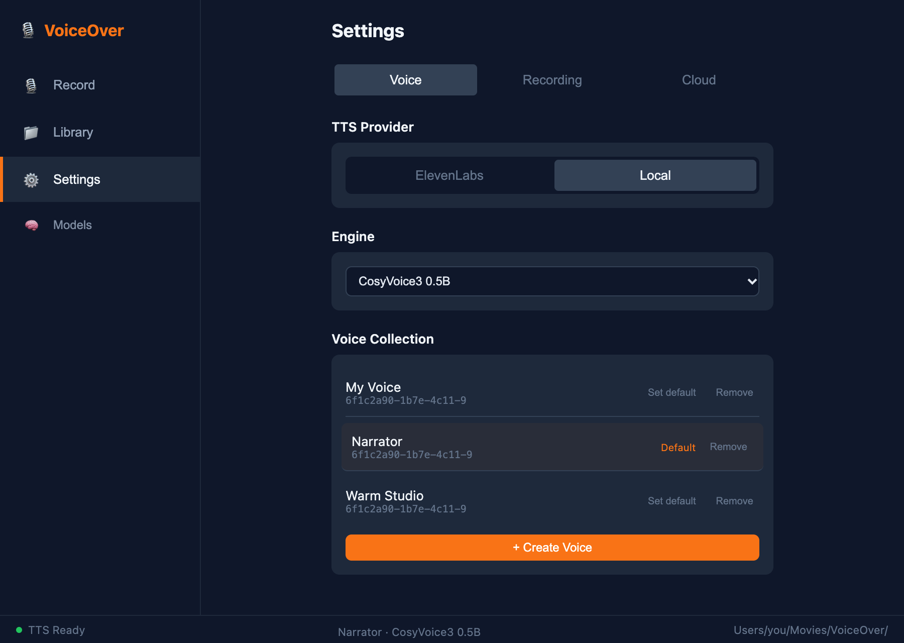
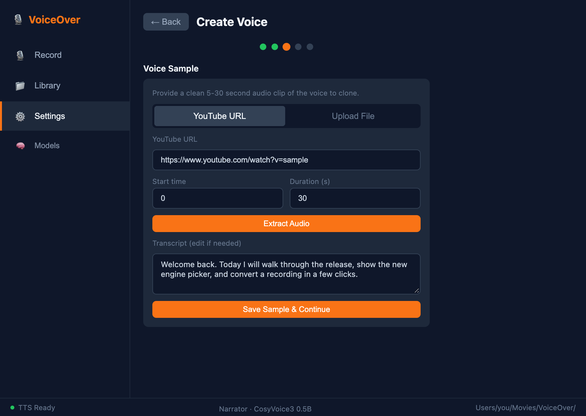
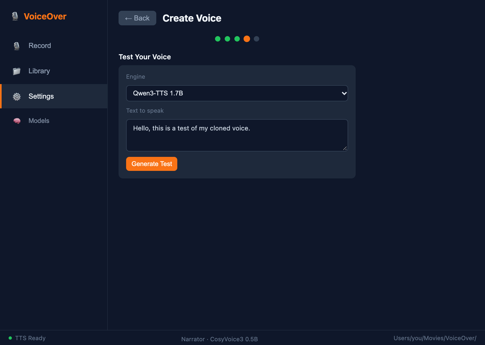
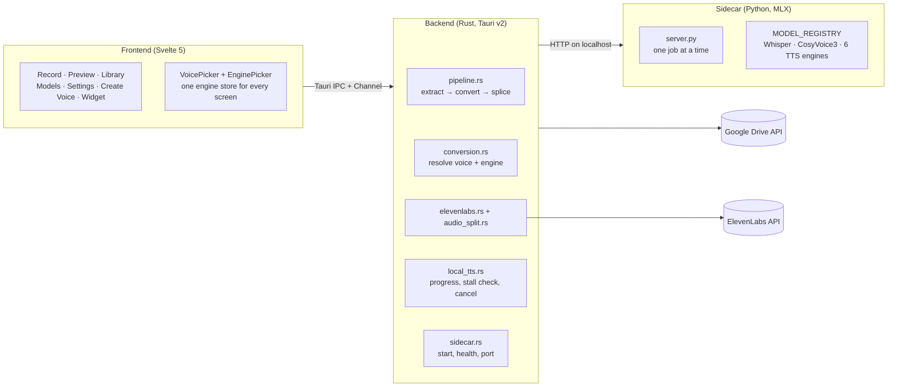

# VoiceOver

A macOS screen recorder that replaces your voice in the recording. Record your screen, pick a voice, and save an MP4 that speaks in it. Voices come from **ElevenLabs** (cloud) or from **seven local engines** that run on Apple Silicon through MLX, with no API key and no audio leaving your Mac.

Built with Tauri v2 (Rust backend), SvelteKit 5 (TypeScript frontend), and a Python FastAPI sidecar for on-device inference.



## What It Does

1. **Record** your screen (full screen, window, or region) with your microphone, and optionally your webcam
2. **Replace your voice** with an ElevenLabs voice or a local voice profile, using the engine you pick
3. **Preview** the result, and **convert it again** in another voice or engine if you don't like it
4. **Keep it** in the Library, or **upload** it to Google Drive for a shareable link

It all happens in one app, with no external tools and no file juggling.

## Screenshots

The engine and model lists below come from a real install. The voices and recordings are sample data.

### Record

Pick the capture mode, microphone and webcam, then the voice. With **Local** selected you also pick the engine; the Voice Replacement card shows what you'll get as "voice · engine". The record screen is at the top of this page.

### Preview

| Converting | Saved |
|---|---|
|  |  |

The progress bar names the engine at work and moves chunk by chunk. **Cancel** stops the conversion and the sidecar job behind it. Once saved, the player shows the converted video, and **Convert again** redoes it from your original voice in any voice and engine.

### Library

| Recordings | Convert again from a card |
|---|---|
|  |  |

Each card shows the voice and engine it was made with. The 🎙️ button converts that recording again without opening it.

### Models



Download, switch and delete models in one place. Each card shows its size and licence, and engines whose licence forbids commercial use carry a **Non-commercial** mark.

### Settings and Create Voice

| Settings | Add a voice sample | Test the voice |
|---|---|---|
|  |  |  |

Settings holds your default provider, engine and voice. Create Voice builds a local voice profile from a 5–30 second clip (uploaded, or cut from a YouTube video), transcribes it, and lets you hear the new voice through any text-to-speech engine before you keep it.

## Local Engines

A local conversion works in one of two ways, decided by the engine you pick:

| Kind | Engine | How it works | What it keeps |
|------|--------|--------------|---------------|
| **Voice conversion** | CosyVoice3 0.5B | Converts the speech itself, 25 seconds at a time | Your pacing, emphasis and pauses |
| **Text-to-speech** | Qwen3-TTS 1.7B, VoxCPM2, MOSS-TTS Local v1.5, OmniVoice, Fish S2 Pro, Chatterbox | Whisper transcribes your recording, then the engine speaks each phrase at its original timestamp | When each phrase starts; within a phrase the engine sets the pace |

| Engine | Kind | Download | Licence |
|--------|------|----------|---------|
| CosyVoice3 0.5B | Voice conversion | 2.4 GB | Apache-2.0 |
| Qwen3-TTS 1.7B | Text-to-speech | 4.5 GB | Apache-2.0 |
| VoxCPM2 | Text-to-speech | 5.0 GB | Apache-2.0 |
| MOSS-TTS Local v1.5 | Text-to-speech | 13.4 GB | Apache-2.0 |
| OmniVoice | Text-to-speech | 1.6 GB | CC BY-NC (**non-commercial**) |
| Fish S2 Pro | Text-to-speech | 11.0 GB | Fish Audio Research (**non-commercial**) |
| Chatterbox | Text-to-speech | 3.2 GB | MIT |
| Whisper Large v3 Turbo | Transcription (recommended) | 1.6 GB | MIT |
| Whisper Medium | Transcription | 1.5 GB | Apache-2.0 |

On a 6m50s recording, CosyVoice replaced the voice in about 40 seconds and Qwen3-TTS in 84 seconds (measured on an M5 Max during the 0.3.0 and 0.4.0 work).

Nothing preselects an engine: until a local voice has one, Convert and Save stay disabled. A new engine is one row in the sidecar's model registry; the pickers, the Models page and the saved metadata all read from it.

## Features

- **Screen capture** — full screen, window, or region selection via the native picker
- **Webcam overlay** — a picture-in-picture bubble composited into the video, bottom-left or bottom-right
- **Microphone selection** — any connected input
- **ElevenLabs speech-to-speech** — background noise removed before conversion; recordings over 5 minutes are split at pauses and rejoined at exact lengths
- **Seven local engines on MLX** — CosyVoice3 plus six text-to-speech engines, no PyTorch
- **Pick the voice and engine per conversion** — on the Record screen, in Settings, on Preview, on a Library card, and in Create Voice
- **Convert again** — every converted recording keeps your original voice as `<name>.original.m4a`, so you can redo it in another voice
- **Live progress and Cancel** — the bar names the engine and moves chunk by chunk; Cancel stops the sidecar job too
- **"Voice · engine" labels** — on Preview, Library cards and the status bar
- **Models page** — download and delete models, see size and licence, choose the Whisper model
- **Voice creation wizard** — create profiles from audio files or YouTube clips, with automatic transcription and a test through any text-to-speech engine
- **Video library** — thumbnails, sort by date, size or name, rename, play, reveal in Finder, delete, upload
- **Voice replacement toggle** — on by default; turn it off to save the raw recording
- **Google Drive upload** — OAuth2 sign-in, returns a shareable link
- **Floating recording widget** — an always-on-top pill with timer and controls

## Architecture



The **Python sidecar** is a FastAPI server that the app starts on a free local port the first time something needs it (with Local as the provider, that's when the app loads your voices). It transcribes with Whisper, runs the voice-conversion and text-to-speech engines, and manages voice profiles and model downloads. Jobs run one at a time in a queue, so a transcription waits its turn and can be cancelled like the rest.

The frontend never calls the sidecar directly: every request goes through the Rust backend (`sidecar_fetch`, `sidecar_upload`, and the conversion commands).

**Processing pipeline:**

```
ElevenLabs:       Record → Extract audio → ElevenLabs S2S (split at pauses past 5 min) → Splice → MP4
Voice conversion: Record → Extract audio → CosyVoice3, 25 s chunks → Splice → MP4
Text-to-speech:   Record → Extract audio → Whisper → engine speaks each phrase at its timestamp → Splice → MP4
```

- Desktop app: the bundled ffmpeg handles extraction and splicing
- Browser mode: ffmpeg.wasm handles splicing in the browser (ElevenLabs only)

## System Requirements

### Apple Silicon (local engines)

The local engines run on [MLX](https://github.com/ml-explore/mlx) and need **Apple Silicon**. Development and measurements were on an **M5 Max**; the minimum M-series chip hasn't been verified. Any M1 or later should work, with speed depending on unified memory and GPU cores.

Download models from the **Models** page in the sidebar. Creating a voice needs only the Whisper model chosen there (**Whisper Large v3 Turbo** by default, 1.6 GB), which transcribes your samples. Converting also needs the engine you pick: **CosyVoice3 0.5B** (2.4 GB) or any text-to-speech engine (1.6–13.4 GB); text-to-speech conversions use Whisper again to transcribe the recording. Models are stored in `~/Library/Application Support/com.voiceover.app/models/`.

> **Note:** If you only use ElevenLabs, you don't need Apple Silicon or any model downloads.

## Installation

### Download

The signed and notarized app for Apple Silicon is on the [Releases page](https://github.com/davidbzyk/voiceover/releases) (`VoiceOver_<version>_aarch64.dmg`). ffmpeg ships inside the app.

### Build from source

**macOS tools:**

```bash
# Xcode command line tools (required for Tauri/WebKit)
xcode-select --install

# ffmpeg (used by development builds)
brew install ffmpeg
```

**Rust:**
```bash
curl --proto '=https' --tlsv1.2 -sSf https://sh.rustup.rs | sh
source $HOME/.cargo/env
```

**Node.js** (v20+):
```bash
# via nvm (recommended)
curl -o- https://raw.githubusercontent.com/nvm-sh/nvm/v0.40.0/install.sh | bash
nvm install 20
```

**pnpm:**
```bash
npm install -g pnpm
```

**Clone and install:**

```bash
git clone https://github.com/davidbzyk/voiceover.git
cd voiceover
pnpm install
```

## Development

```bash
# Start the desktop app in dev mode (hot-reloads both Svelte and Rust)
pnpm tauri dev

# Or run just the frontend (browser mode at http://localhost:5170)
pnpm dev
```

The desktop app opens a native window.

### Browser Mode

While `pnpm tauri dev` runs, you can also use the app in Chrome at `http://localhost:5170`. This mode:

- Records using browser WebRTC APIs (works reliably in Chrome)
- Calls ElevenLabs S2S directly via `fetch` (local engines need the desktop app)
- Splices video + audio using ffmpeg.wasm (loaded from `static/ffmpeg/`)
- Stores settings in `localStorage`

**Config precedence:**
1. **Tauri app config** — stored in the OS app data directory (primary, used at runtime)
2. **`static/_config.json`** — development/build-time fallback only, stripped from production builds

## Testing

```bash
# Run all tests (frontend + backend)
pnpm test:all

# Frontend only (Vitest)
pnpm test

# Backend only (Rust)
pnpm test:rust

# Watch mode (frontend, re-runs on file changes)
pnpm test:watch

# Coverage reports with HTML graphs
pnpm test:coverage          # Frontend → coverage/index.html
pnpm test:rust:coverage     # Backend  → src-tauri/target/llvm-cov/html/index.html
pnpm test:all:coverage      # Both
```

Pre-commit hooks (via [lefthook](https://github.com/evilmartians/lefthook)) run frontend tests, Rust tests, and type checking in parallel before every commit. Every pull request also gets an automated code review from the copy of the reviewer in `.code-review/`.

## Building for Distribution

```bash
# Build optimized release bundles
pnpm tauri build
```

This produces a `.dmg` installer in `src-tauri/target/release/bundle/dmg/`, code-signed with a Developer ID and hardened runtime. The release steps (sidecar build, signing, notarization) are in [docs/BUILD.md](docs/BUILD.md).

## Configuration

All settings are managed in the app. No config files to edit by hand.

### ElevenLabs Setup

1. Get an API key from [elevenlabs.io](https://elevenlabs.io)
2. Open Settings in the app
3. Enter your API key and click **Test** to verify
4. Add voices: enter a **name** and **voice ID** (find IDs in your ElevenLabs voice library)
5. Set a default voice

> **Tip:** Set `export ELEVENLABS_API_KEY=sk_...` in your shell profile (`.zshrc` / `.bashrc`) and the app will pick it up, with no need to enter the key in Settings.

### Local Voice Setup (Optional)

The local engines are built into VoiceOver. The app starts the sidecar itself when it's first needed; there's no server to install.

**1. Download models:** open **Models** in the sidebar and download the Whisper model (needed to create voices), then the engines you want to convert with: CosyVoice3 to keep your exact timing, or any text-to-speech engine.

**2. Create a voice profile:**

1. In **Settings → Voice**, click **+ Create Voice**
2. Name the voice and add a sample: upload a file, or paste a YouTube URL with a start time and duration
3. The sample is transcribed automatically; fix the transcript if needed
4. Test it with any downloaded text-to-speech engine (with none downloaded, you can skip the test)
5. Use clean 5–30 second samples; quality depends on them

**3. Pick the voice and engine:**

1. On the **Record** screen, switch the provider to **Local**
2. Choose the **Engine** (CosyVoice3 to keep your exact timing, or a text-to-speech engine) and the voice profile
3. Record as normal. Preview and Library cards let you pick a different voice or engine for any single conversion

**Supported audio formats for samples:** `.wav`, `.mp3`, `.m4a`, `.ogg`, `.flac`, `.aac`, `.webm`, `.opus`

### Google Drive Setup (Optional)

1. Create a project in [Google Cloud Console](https://console.cloud.google.com)
2. Enable the Google Drive API
3. Create OAuth 2.0 credentials (Desktop application type)
4. In the app Settings, enter the **Client ID** and **Client Secret**
5. Click **Connect Google Drive** and authorize

After connecting, the app provides a shareable Google Drive link when you save a recording.

### Settings Storage

- **Desktop app:** `~/Library/Application Support/com.voiceover.app/config.json` (API keys and tokens go to the macOS Keychain)
- **Browser mode:** `localStorage` (with `static/_config.json` as dev-only fallback, stripped from production builds)

## Project Structure

```
voiceover/
├── src/                              # Svelte frontend
│   ├── app.css                       # Global styles (dark theme)
│   ├── lib/
│   │   ├── recorder.svelte.ts        # WebRTC capture + MediaRecorder
│   │   ├── state.svelte.ts           # App state (Svelte 5 runes)
│   │   ├── conversion.ts             # Voice choices + convert / convert again / cancel commands
│   │   ├── activeConversion.svelte.ts # The one conversion running, and which screen owns it
│   │   ├── localVoice.svelte.ts      # Shared store of local profiles and engine rows
│   │   ├── EnginePicker.svelte       # Engine dropdown (Record, Settings, Preview, Library, Create Voice)
│   │   ├── VoicePicker.svelte        # Voice + engine picker for a single conversion
│   │   ├── ModelCard.svelte          # One model on the Models page
│   │   ├── voicebox.ts               # Sidecar client (routes through Tauri IPC)
│   │   ├── models.ts                 # Model metadata helpers
│   │   ├── library.svelte.ts         # Video library state & sorting
│   │   ├── drive.ts                  # Google Drive upload utilities
│   │   ├── tauri.ts                  # IPC wrapper (tauriInvoke)
│   │   ├── logger.ts                 # Structured logging ([VO:*] prefix)
│   │   ├── Sidebar.svelte            # Navigation sidebar
│   │   ├── StatusBar.svelte          # Bottom status bar (TTS status, voice · engine, output dir)
│   │   ├── RecordingCard.svelte      # Library card (thumbnail, actions, convert again)
│   │   ├── WebcamBubble.svelte       # Webcam bubble overlay (live preview)
│   │   └── RegionSelector.svelte     # Screen region selection overlay
│   └── routes/
│       ├── (app)/
│       │   ├── +layout.svelte        # App shell, config loading
│       │   ├── +page.svelte          # Record screen
│       │   ├── preview/+page.svelte  # Preview, convert, save, convert again
│       │   ├── library/+page.svelte  # Video library
│       │   ├── models/+page.svelte   # Models page
│       │   ├── settings/+page.svelte # Voice, Recording and Cloud settings
│       │   └── create-voice/+page.svelte # Voice creation wizard
│       └── widget/+page.svelte       # Floating recording widget
├── src-tauri/                        # Rust backend
│   ├── tauri.conf.json
│   ├── entitlements.plist            # macOS security entitlements
│   ├── capabilities/default.json     # Tauri permissions
│   └── src/
│       ├── lib.rs                    # Tauri builder, command registration
│       ├── config.rs                 # JSON config read/write + env var fallback
│       ├── secrets.rs                # Keychain storage for API keys and tokens
│       ├── prerequisites.rs          # ffmpeg detection
│       ├── ffmpeg.rs                 # Audio extraction, muxing, duration probing
│       ├── pipeline.rs               # Save / convert / convert again orchestration
│       ├── conversion.rs             # Resolves voice + engine, runs ElevenLabs or a local engine
│       ├── elevenlabs.rs             # ElevenLabs S2S client
│       ├── audio_split.rs            # Splits long ElevenLabs audio at pauses
│       ├── local_tts.rs              # Sidecar job client (progress, stall check, cancel)
│       ├── models.rs                 # Model download + status
│       ├── sidecar.rs                # Sidecar process management (start/stop/health)
│       ├── library.rs                # Library (list, rename, delete, thumbnails)
│       ├── google_drive.rs           # OAuth2 + upload
│       ├── tts_provider.rs           # Provider enum (ElevenLabs / Local)
│       └── commands/
│           ├── recording.rs          # Chunk saving, finalization
│           └── window.rs             # Widget window management
├── src-tauri/sidecar/                # Python sidecar (FastAPI)
│   ├── server.py                     # Routes, job queue, MODEL_REGISTRY
│   ├── tts.py                        # Registry-driven MLX engine loading + Whisper transcription
│   ├── cosyvoice_mlx/                # CosyVoice3 on MLX (copied MIT code; loader.py is ours)
│   ├── chunked_tts.py                # Chunking + timestamp-aware assembly
│   ├── profiles.py                   # Voice profile management
│   ├── requirements.txt              # Python dependencies (mlx, mlx-audio; no torch)
│   └── voiceover-tts.spec            # PyInstaller build spec
├── scripts/
│   ├── build-sidecar.sh              # Build + sign + test the sidecar binary
│   ├── bump-version.sh               # Release version bump
│   └── check-cosyvoice-copy.sh       # Checks cosyvoice_mlx against its source
├── okf/                              # Knowledge bundle: what we tried, what broke, the rules that came out
├── docs/                             # Build guide, plans, reviews
├── .code-review/                     # This repo's copy of the PR code reviewer
├── static/ffmpeg/                    # ffmpeg.wasm core (browser mode)
└── images/                           # README screenshots
```

## Tech Stack

| Layer | Technology |
|-------|-----------|
| Desktop framework | Tauri v2 |
| Frontend | Svelte 5 + SvelteKit, TypeScript |
| Backend | Rust |
| Video processing | ffmpeg (CLI) / ffmpeg.wasm (browser) |
| Voice (cloud) | ElevenLabs Speech-to-Speech v1 |
| Voice (local) | Python sidecar on MLX: CosyVoice3 (voice conversion) + six text-to-speech engines |
| Transcription | Whisper Large v3 Turbo or Whisper Medium on MLX |
| HTTP client | reqwest (Rust) / fetch (browser) |
| Cloud upload | Google Drive API v3 |
| State management | Svelte 5 runes |

## Command & API Reference

### Tauri Commands

The IPC commands the Rust backend exposes, invoked from the frontend via `tauriInvoke()`.

| Command | Description |
|---|---|
| `check_prerequisites` | Verify system dependencies (ffmpeg) |
| `get_config` | Read app configuration |
| `save_config` | Write app configuration |
| `save_recording_chunk` | Save a recording chunk to disk |
| `finalize_recording` | Finalize recording and produce output file |
| `get_temp_dir` | Get the app's temp directory path |
| `read_file_bytes` | Read a file as raw bytes |
| `create_widget_window` | Open the floating recording widget |
| `close_widget_window` | Close the floating recording widget |
| `process_recording` | Save a recording, replacing the voice if asked (reports progress on a channel) |
| `reconvert_recording` | Convert a saved recording again from its original voice |
| `cancel_conversion` | Stop the conversion in progress, and its sidecar job |
| `test_api_key` | Validate an ElevenLabs API key |
| `test_local_connection` | Check sidecar connectivity |
| `list_local_voices` | List voice profiles from the sidecar |
| `check_model_status` | List models and engines with download state, size and licence |
| `extract_youtube_audio` | Extract audio from a YouTube URL via the sidecar |
| `poll_generation` | Poll a sidecar job's status |
| `get_generation_audio` | Download a sidecar job's audio as bytes |
| `sidecar_fetch` | Proxy a GET/POST request to the sidecar |
| `sidecar_upload` | Proxy a file upload to the sidecar |
| `get_sidecar_status` | Get sidecar process status |
| `download_model` | Download a model from Hugging Face |
| `delete_model` | Delete a downloaded model |
| `get_models_disk_usage` | Get disk usage of downloaded models |
| `google_drive_connect` | Start Google Drive OAuth2 flow |
| `google_drive_disconnect` | Disconnect Google Drive |
| `upload_to_drive` | Upload a file to Google Drive |
| `list_recordings` | List saved recordings with metadata |
| `generate_thumbnail` | Extract a thumbnail JPEG from a video |
| `delete_recording` | Delete a recording and its companions |
| `rename_recording` | Rename a recording file |
| `open_in_system` | Open a file with the default system app |
| `reveal_in_finder` | Reveal a file in Finder |

### Sidecar Routes

HTTP endpoints served by the Python FastAPI sidecar on localhost.

| Route | Method | Description |
|---|---|---|
| `/health` | GET | Health check + model availability |
| `/transcribe` | POST | Transcribe uploaded audio (Whisper) |
| `/transcribe-path` | POST | Transcribe audio from a file path on disk |
| `/generate` | POST | Queue a text-to-speech job (returns a generation ID) |
| `/generate/{gen_id}/status` | GET | Poll a job's status and chunk progress |
| `/generate/{gen_id}/cancel` | POST | Cancel a queued or running job |
| `/audio/{gen_id}` | GET | Download a job's audio |
| `/voice-convert` | POST | Replace the voice in a recording: CosyVoice converts it, a text-to-speech engine transcribes and re-speaks it |
| `/extract-youtube` | POST | Download YouTube audio, extract and clip to WAV |
| `/profiles` | GET | List all voice profiles |
| `/profiles` | POST | Create a new voice profile |
| `/profiles/{id}/samples` | POST | Upload a voice sample to a profile |
| `/profiles/{id}/samples/from-path` | POST | Add a voice sample from a file path on disk |
| `/profiles/{id}` | DELETE | Delete a voice profile |
| `/models/status` | GET | Model download/load status, size and licence |
| `/models/download` | POST | Download a model (streams progress as SSE) |
| `/models/{model_name}` | DELETE | Delete a downloaded model |

## Debugging

### Browser Console

Open DevTools (F12) and filter by `[VO:` to see app logs:

```
[VO:config]     Loaded from static/_config.json
[VO:record]     Starting capture: fullscreen
[VO:record]     Screen stream: monitor 1
[VO:record]     Audio stream: Default Mic
[VO:record]     Chunk 0: 245.3KB
[VO:elevenlabs] Speech-to-Speech: voice=Cb8NLd0s
[VO:elevenlabs] S2S complete in 3.2s
[VO:pipeline]   Splicing video + audio (75%)
[VO:pipeline]   Complete: voiceover-1234567890.webm (2.1MB)
```

### Rust Terminal

When running `pnpm tauri dev`, Rust logs appear in the terminal:

```
[elevenlabs] S2S request: voice=Cb8NLd0s, input_size=156KB
[elevenlabs] S2S response: status=200, elapsed=3.2s
[pipeline] Complete: /Users/you/Movies/VoiceOver/voiceover-123.mp4 (total 4.1s)
```

The installed app writes the same logs to `~/Library/Logs/com.voiceover.app/VoiceOver.log`.

## Known Issues

- **Sidecar startup lag** — the sidecar takes 10–30 seconds to start the first time the app needs it. Until then local voice profiles don't appear in the pickers; the status bar shows "TTS Ready" once it's up.
- **Apple Silicon only for local engines** — they run on MLX. ElevenLabs works on any hardware.
- **Voice quality depends on your samples** — clean, varied samples of 5–30 seconds give the best clones; noisy reference audio gives poor ones.
- **Non-commercial engines** — OmniVoice (CC BY-NC) and Fish S2 Pro (Fish Audio Research licence) are marked on the Models page; don't use them for commercial work.
- **Long pauses in a conversion** — once a local conversion has finished a chunk, 240 seconds with no new chunk fails it. A first-time model download or a transcription has no time limit and can be cancelled.
- **Webcam bubble** — bottom-left or bottom-right only, captured at 640x480 @ 30fps.
- **Google Drive OAuth** — the connection must be made from the desktop app (it uses a loopback redirect).
- **TTS audio cutoff** — local text-to-speech output may cut off the last 1–2 seconds abruptly. Under investigation.

## License

MIT
